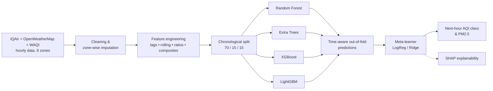
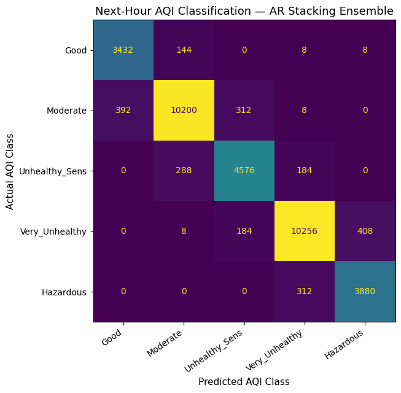
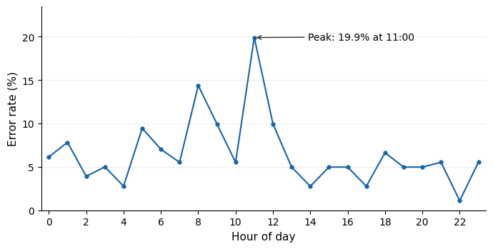
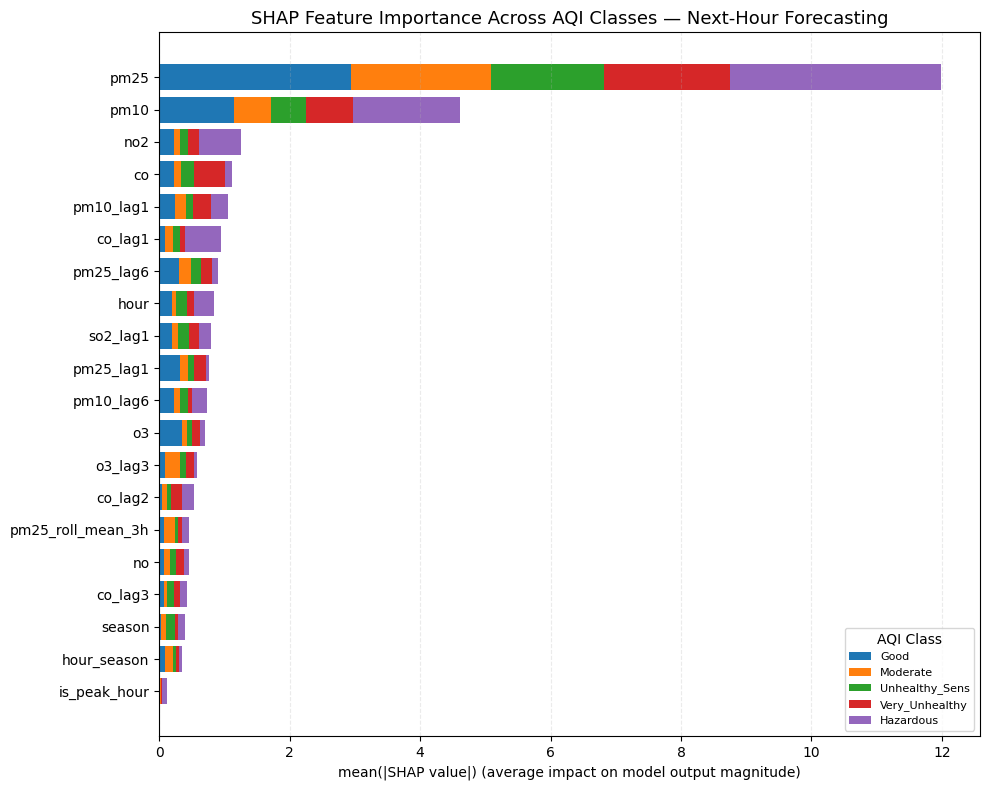
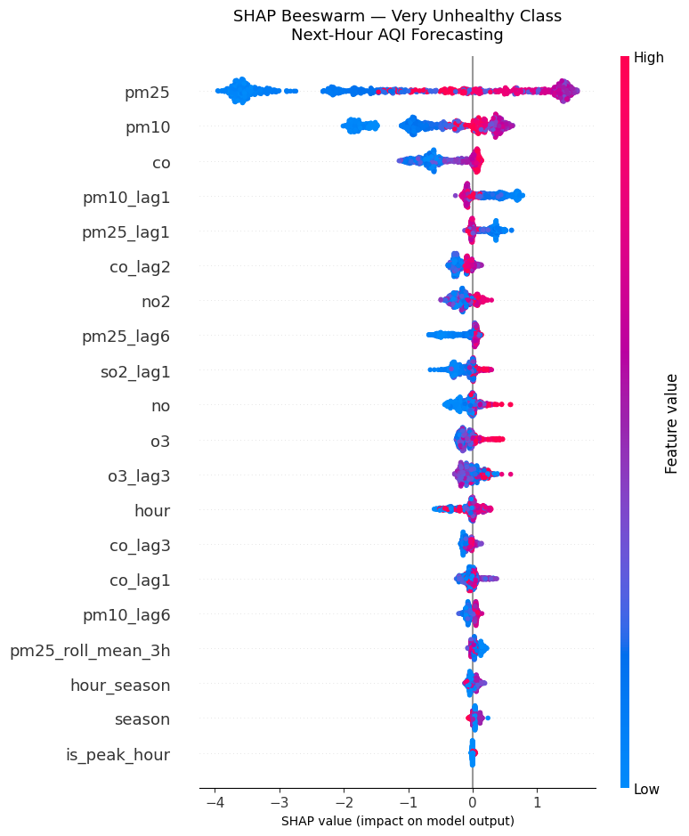

<div align="center">

# 🌫️ Dhaka AQI Forecasting

### Zone-wise Next-Hour Air Quality Forecasting for Dhaka with Stacking Ensembles and SHAP Explainability


**Next-hour AQI category and PM2.5 forecasting across 8 zones of Dhaka from 236,216 hourly multi-source records**

[Overview](#-overview) •
[Highlights](#-key-results) •
[Methodology](#%EF%B8%8F-methodology) •
[Results](#-results) •
[Explainability](#-explainability-shap) •
[How to Run](#-how-to-run)

</div>

---

## 📖 Overview

Dhaka is one of the most polluted megacities in the world, yet most studies treat it as a **single spatial unit**
and predict air quality at **daily** resolution. This project builds an **hourly, zone-wise forecasting system**
for eight areas of Dhaka and evaluates it honestly against a **persistence baseline** ("next hour = this hour").

Three complementary tasks are solved:

| # | Task | Type | Target |
|---|---|---|---|
| 1 | **Next-hour AQI category** | Forecasting (classification) | US EPA AQI class of PM2.5 at *t + 1* |
| 2 | **Next-hour PM2.5** | Forecasting (regression) | PM2.5 concentration (µg/m³) at *t + 1* |
| 3 | Same-hour AQI category | Baseline (classification) | AQI class at *t*, used as a task-difficulty reference |

**Zones covered:** Azimpur • Baridhara • Dhanmondi • Gulshan • Mirpur • Mohammadpur • Motijheel • Uttara

**AQI classes:** Good • Moderate • Unhealthy for Sensitive Groups • Very Unhealthy • Hazardous

---

## 🏆 Key Results

| Task | Model | Metric | Score |
|---|---|---|---|
| Next-hour PM2.5 regression | **Stacking ensemble (Ridge meta-learner)** | R² | **0.9900** |
| | | MAE / RMSE | **2.79 / 6.11 µg/m³** |
| | | vs. persistence | **15.7% lower MAE, 26.1% lower RMSE** |
| Next-hour AQI classification | Autoregressive stacking (LogReg meta-learner) | Accuracy / Macro-F1 | 93.48% / 0.9279 |
| Same-hour AQI classification | XGBoost + LightGBM soft voting | Accuracy / Macro-F1 | 95.03% / 0.9418 |

> 💡 **Honest benchmarking:** for next-hour *category* classification, the persistence baseline (94.50%) is
> slightly ahead of the model because hourly AQI is strongly auto-correlated. The project reports this openly
> and analyses category-transition hours separately. For *regression*, the stacking ensemble clearly
> beats both persistence and every individual base model.

---

## ⚙️ Methodology



### 1. Data
- **236,216 hourly records** (Jan 2023 – Jun 2026) from **IQAir**, **OpenWeatherMap** and **WAQI**, merged per zone and timestamp
- **81 attributes**:
  - Pollutants: PM2.5, PM10, NO₂, O₃, SO₂, CO, NH₃, NO
  - Zone coordinates
  - Weather variables
  - Calendar features: hour, season, peak hour

### 2. Preprocessing
- Removed duplicates and rows without PM2.5; invalid negative PM10 values set to missing
- **Train-only** zone-wise median imputation, so no information leaks from validation or test data
- Dropped leakage columns (e.g. the API's own AQI value)

### 3. Feature Engineering
- **Lag features:** `x(t−τ)` for τ ∈ {1, 2, 3, 6, 12} hours
- **Rolling statistics:** mean and standard deviation over 3 h and 6 h windows, shifted by one hour to avoid leakage
- **Composite indices:** pollution index `PM2.5 + NO₂ + O₃` and oxidant index `NO₂ + O₃`
- **Feature selection** by XGBoost importance: top-30 (same-hour) and top-20 (next-hour) features. The autoregressive variant adds the current AQI class as the 21st input.

### 4. Models
- **Base learners:** Random Forest, Extra Trees, XGBoost, LightGBM (regularised, class-balanced)
- **Stacking:**
  - Base-model probabilities and predictions come from **5-fold expanding-window `TimeSeriesSplit` OOF**
  - These feed a **Logistic Regression** meta-learner (classification) or a **Ridge** meta-learner (regression)
- **Validation-tuned hyperparameters:** LogReg `C = 0.025`, Ridge `α = 100`, soft-voting weight `w = 0.5`
- **Strict chronological split:** train Jan 2023 – Jun 2025, validation Jun – Dec 2025, test Dec 2025 – Jun 2026

### 5. Evaluation
- Accuracy, macro precision / recall / F1, MAE, RMSE, R²
- Comparison with a **persistence baseline** and a re-implemented **Random-Subspace** Dhaka model
- **Zone-wise** and **hour-of-day** error analysis, **category-transition** analysis
- **Statistical testing:** day-block bootstrap 95% CIs and a paired Wilcoxon signed-rank test

---

## 📊 Results

### Next-hour PM2.5 regression (test set)

| Model | MAE (µg/m³) ↓ | RMSE (µg/m³) ↓ | R² ↑ |
|---|---|---|---|
| **Stacking ensemble** | **2.7896** | **6.1076** | **0.9900** |
| LightGBM | 2.8638 | 6.4881 | 0.9887 |
| Persistence baseline | 3.3075 | 8.2671 | 0.9817 |
| Random Subspace-style (prior Dhaka work) | 30.2358 | 35.6102 | 0.6610 |

### Next-hour AQI classification (test set, 34,600 rows)

| Model | Accuracy | Macro-P | Macro-R | Macro-F1 |
|---|---|---|---|---|
| Persistence baseline | 0.9450 | 0.9395 | 0.9396 | 0.9395 |
| **AR stacking** | 0.9348 | 0.9228 | 0.9334 | 0.9279 |
| Non-AR stacking | 0.8805 | 0.8547 | 0.8963 | 0.8715 |

<p align="center">
  
  
</p>

- **98.6%** of misclassifications fall into an **adjacent** AQI category.
- Errors depend on **time of day**, not on location: they peak at **11:00 (19.9%)** and are lowest at **22:00 (1.1%)**. The likely causes are the morning boundary-layer break-up and traffic.
- Performance is nearly identical across all **8 zones** (error rate ≈ 6.5%), which suggests shared pollution sources across the city.

### Same-hour AQI classification baseline

| Model | Accuracy | Macro-F1 |
|---|---|---|
| **XGBoost + LightGBM soft voting** | **0.9503** | **0.9418** |
| LightGBM | 0.9476 | 0.9385 |
| XGBoost | 0.9094 | 0.9124 |
| Four-model weighted vote | 0.8621 | 0.8729 |
| Four-model stacking | 0.8134 | 0.8284 |

---

## 🔍 Explainability (SHAP)

`TreeExplainer` was run on the non-autoregressive XGBoost model to see which features drive each AQI class.

<p align="center">
  
  
</p>

- **PM2.5** is by far the most influential predictor across all classes, followed by **PM10**.
- Gaseous pollutants (**NO₂, CO**) and **lagged** pollutant values add further signal.
- The zone-wise mean |SHAP| is almost uniform (0.289–0.293), so a single pooled model works well across zones.

---

## 🚀 How to Run

The notebook was developed on **Google Colab** with data and checkpoints stored on Google Drive.

1. Open [`notebooks/Dhaka_AQI_Stacking_Final.ipynb`](notebooks/Dhaka_AQI_Stacking_Final.ipynb) in Google Colab.
2. Upload the dataset `dhaka_aqi_final_featured.csv` to `MyDrive/AQI_Project/`.
3. Run the cells from top to bottom. The notebook mounts Drive, installs dependencies, trains the models and saves results, models and figures.

To run locally instead:

```bash
git clone https://github.com/Samiulhasan1910/Dhaka-AQI-Forecasting.git
cd Dhaka-AQI-Forecasting
pip install -r requirements.txt
jupyter notebook notebooks/Dhaka_AQI_Stacking_Final.ipynb
```

When running locally, change `PROJECT_DIR` in the notebook to a local folder.

> 📁 The processed dataset and trained models are **not included** in this repository because of their size.

**Hardware used:**
- Intel Xeon 2.20 GHz CPU (2 cores), 12.67 GB RAM, plus a Colab T4 GPU for XGBoost
- Full-stack inference takes about 371 ms for a single row

---

## 📁 Repository Structure

```
Dhaka-AQI-Forecasting/
├── notebooks/
│   └── Dhaka_AQI_Stacking_Final.ipynb   # Full pipeline: preprocessing → models → evaluation → SHAP
├── figures/                             # Key result figures used in this README
├── requirements.txt                     # Python dependencies
└── README.md
```

---

## 🔮 Future Work

- Transition-aware training objectives to better catch AQI category changes
- Longer forecast horizons (3 h, 6 h, 24 h)
- A hybrid policy that falls back to persistence during stable hours
- Zone-specific models and full-stack SHAP attribution

---

## 📄 Publication

A research paper based on this work is currently **under review**. Citation
details will be added here once it is published.

---

## 👥 Research Team

Department of Computer Science, **American International University-Bangladesh (AIUB)**

| Name | Role |
|---|---|
| Sajal Kumar Ghosh | Researcher |
| Arpa Saha | Researcher |
| **Samiul Hasan** ([@Samiulhasan1910](https://github.com/Samiulhasan1910)) | Researcher |
| Aditya Roy | Researcher |
| Dip Sarker | Researcher |
| Kamruddin Nur | Supervisor |

Supported by the **Ubiquitous, Cloud, and Human-Computer Interaction (UCH) Research Group**, AIUB.

---

<div align="center">

⭐ If you find this project useful, please give it a star! ⭐

Made with 💨 for cleaner air in Dhaka

</div>
